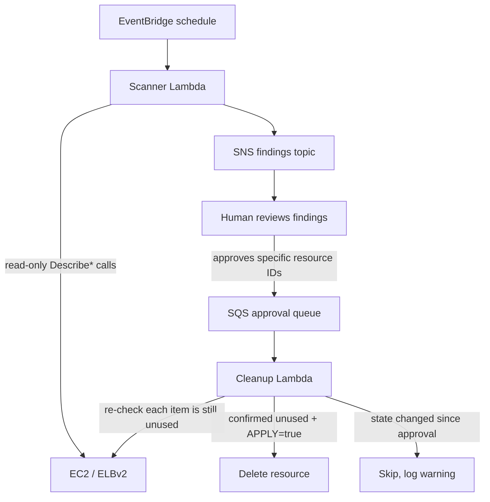

# Unused resource cleanup

Scheduled AWS Lambda pair that finds unused EC2/ELB resources and deletes
only what a human has explicitly approved.

**Scope:** AWS only. The original brief mentioned Azure Functions as an
alternative; this implementation is AWS Lambda only, and that is the only
scope covered here.

## What it scans for

- Elastic IPs with no association
- AMIs older than an age threshold that are not referenced by any instance
- Security groups not referenced by any network interface (excluding `default`)
- Load balancers with no healthy registered target across all target groups

Anything carrying a configurable protect tag (`cleanup-protect=true` by
default) is skipped during scanning.

## Flow



## Why two phases with SNS/SQS

The scanner never deletes anything. It only publishes findings. A human
reviews the findings and is responsible for producing an approval message
on SQS that names the specific resources to delete (how that approval
message gets created — e.g. a manual script, a chat-ops action — is out of
scope here; this repo only defines the message contract and consumes it).

The cleanup Lambda trusts nothing from the original scan: it re-reads live
AWS state for every approved resource right before deleting it. If a
resource no longer matches the condition it was approved under (for
example, someone attached the security group in the meantime), the item is
skipped and logged instead of deleted. This closes the race window between
"found unused" and "approved for deletion."

## Dry-run by default

The cleanup Lambda only deletes when the `APPLY` environment variable is
set to a truthy value. Without it, every approved item is logged as
"would delete" and nothing is touched. There is no equivalent flag on the
scanner since it never deletes anything.

## Usage

```bash
pip install -r requirements-dev.txt
pytest -q
ruff check src tests
```

The handlers (`cleanup.scanner.handler`, `cleanup.cleanup.handler`) are
written to be deployed as-is as Lambda function entry points
(`cleanup.scanner.handler`, `cleanup.cleanup.handler`), given the
environment variables below. No deployment tooling (SAM/CDK/Terraform) is
included — this repo is the application logic plus IAM policies, not a
deployment pipeline.

### Scanner environment variables

- `FINDINGS_TOPIC_ARN` (required): SNS topic to publish findings to
- `AMI_AGE_THRESHOLD_DAYS` (default `90`)
- `PROTECT_TAG_KEY` / `PROTECT_TAG_VALUE` (default `cleanup-protect` / `true`)
- `AWS_REGION` (default `us-east-1`)

### Cleanup environment variables

- `APPLY` (default unset/false): set to `true` to actually delete
- `AWS_REGION` (default `us-east-1`)

Sample messages are in `fixtures/sns_finding_message.json` and
`fixtures/sqs_approval_message.json`. IAM policies with the minimum
actions each Lambda needs are in `iam/scanner-policy.json` and
`iam/cleanup-policy.json`.

## Limits

- Load balancer orphan detection only inspects target health, not request
  metrics, access logs, or listener rules.
- AMI "in use" check only looks at `DescribeInstances` across all
  reservations; it does not check launch templates, Auto Scaling groups,
  or other AMI references (snapshots, other accounts via sharing).
- The re-check gate only re-validates the "unused" condition; it does not
  detect a resource being renamed/retagged to use a different ID.
- Several of the EC2 delete actions used here (`ReleaseAddress`,
  `DeregisterImage`, `DeleteSecurityGroup`) do not support resource-level
  IAM scoping, so those statements use `Resource: "*"`. The SNS/SQS/log
  statements are scoped to specific ARNs.
- No retry/backoff logic around AWS API calls is implemented; a failure
  mid-batch stops that record but does not roll back earlier deletes in
  the same invocation.

## Security notes

No AWS credentials are used anywhere in this repo; all tests run against
hand-written fakes of the boto3 clients. The IAM policies in `iam/` are
least-privilege examples for a real deployment, scoped to account
`123456789012` and region `us-east-1` as placeholders — replace with real
values before use.

## Idempotency

Running the scanner twice with no state change produces the same
findings. Running the cleanup Lambda twice on the same approval message is
safe: the second run's re-check will find each resource already gone (for
successfully deleted items) and skip it rather than erroring.

## Testing status

Tested: scan logic for all four resource kinds (including protect-tag and
age-threshold negative cases), SNS publish payload shape, cleanup re-check
gate for all four kinds (including "state changed, must skip" negative
cases), dry-run vs apply behavior, and end-to-end handler tests against
SQS-shaped events. All AWS clients are hand-written fakes — no moto, no
real AWS account, no network calls anywhere in this repo.

Not tested: this has never been deployed to or run against a real AWS
account. Lambda packaging/deployment, EventBridge scheduling, and the
SNS/SQS wiring between the two Lambdas are not exercised — only the
Python logic inside each handler is.
