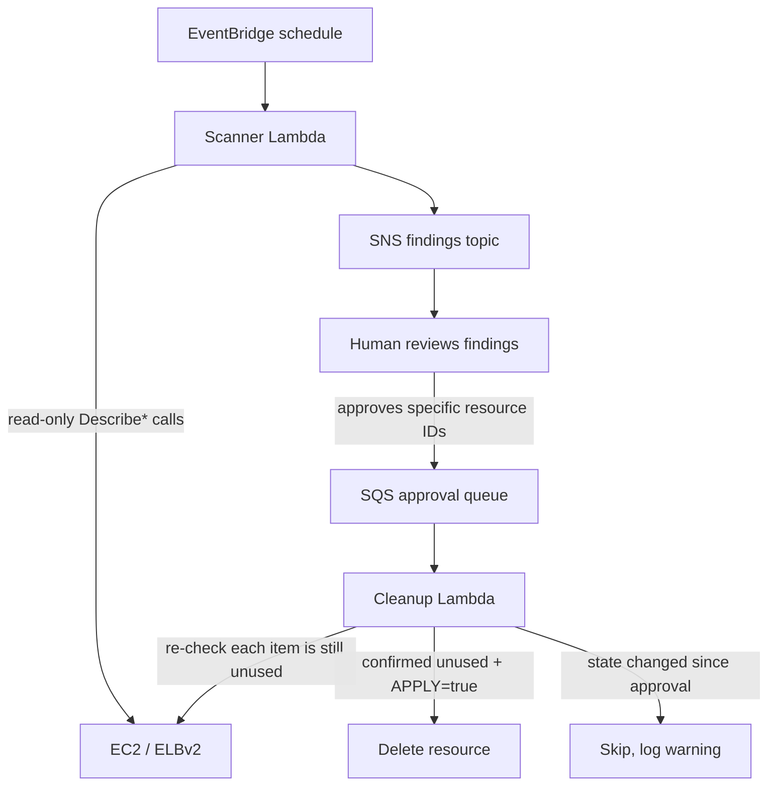

# Unused AWS resource cleanup Lambda

Scheduled AWS Lambda pair that finds unused EC2/ELB resources and deletes
only what a human has explicitly approved.

Why it matters: unattached Elastic IPs, old AMIs, unused security groups and
idle load balancers keep costing money and clutter every audit, but deleting
them automatically is risky. Splitting "find" from "delete" with a human in
between keeps the savings without the surprise.

**Scope:** AWS only. The original brief mentioned Azure Functions as an
alternative; this implementation is AWS Lambda only, and that is the only
scope covered here.

## What it scans for

- Elastic IPs with no association
- AMIs older than an age threshold that are not referenced by any instance
- Security groups not referenced by any network interface (excluding `default`)
- Load balancers with no healthy registered target across all target groups

Anything carrying a configurable protect tag (`cleanup-protect=true` by
default) is skipped during scanning.

## Flow



## Why two phases with SNS/SQS

The scanner never deletes anything. It only publishes findings. A human
reviews the findings and is responsible for producing an approval message
on SQS that names the specific resources to delete (how that approval
message gets created — e.g. a manual script, a chat-ops action — is out of
scope here; this repo only defines the message contract and consumes it).

The cleanup Lambda trusts nothing from the original scan: it re-reads live
AWS state for every approved resource right before deleting it. If a
resource no longer matches the condition it was approved under (for
example, someone attached the security group in the meantime), the item is
skipped and logged instead of deleted. This closes the race window between
"found unused" and "approved for deletion."

## Dry-run by default

The cleanup Lambda only deletes when the `APPLY` environment variable is
set to a truthy value. Without it, every approved item is logged as
"would delete" and nothing is touched. There is no equivalent flag on the
scanner since it never deletes anything.

## Usage

```bash
pip install -r requirements-dev.txt
pytest -q
ruff check src tests
```

The handlers (`cleanup.scanner.handler`, `cleanup.cleanup.handler`) are
written to be deployed as-is as Lambda function entry points
(`cleanup.scanner.handler`, `cleanup.cleanup.handler`), given the
environment variables below. No deployment tooling (SAM/CDK/Terraform) is
included — this repo is the application logic plus IAM policies, not a
deployment pipeline.

### Scanner environment variables

- `FINDINGS_TOPIC_ARN` (required): SNS topic to publish findings to
- `AMI_AGE_THRESHOLD_DAYS` (default `90`)
- `PROTECT_TAG_KEY` / `PROTECT_TAG_VALUE` (default `cleanup-protect` / `true`)
- `AWS_REGION` (default `us-east-1`)

### Cleanup environment variables

- `APPLY` (default unset/false): set to `true` to actually delete
- `AWS_REGION` (default `us-east-1`)

Sample messages are in `fixtures/sns_finding_message.json` and
`fixtures/sqs_approval_message.json`. IAM policies with the minimum
actions each Lambda needs are in `iam/scanner-policy.json` and
`iam/cleanup-policy.json`.

## Known limitations

- Load balancer orphan detection only inspects target health, not request
  metrics, access logs, or listener rules.
- The AMI "in use" check only looks at instances (`DescribeInstances`,
  every page). It does **not** look at launch templates or Auto Scaling
  launch configurations, so an AMI that only a launch template or launch
  configuration references can be approved and deregistered, and the next
  scale-out would then fail. It also ignores other AMI references (other
  accounts via sharing).
- The re-check gate only re-validates the "unused" condition; it does not
  detect a resource being renamed/retagged to use a different ID.
- The scanner's own list calls are not paginated yet; the cleanup recheck
  is. A resource the scanner misses on a later page can't be deleted by
  mistake, because the recheck reads every page before any delete.
- No retry/backoff logic around AWS API calls is implemented; a failure
  mid-batch stops that record but does not roll back earlier deletes in
  the same invocation.

## IAM scoping (checked against AWS docs)

Checked on 2026-11-20 against the AWS Service Authorization Reference
("Actions, resources, and condition keys" for Amazon EC2 and for Elastic
Load Balancing V2, `docs.aws.amazon.com/service-authorization/latest/reference/list_ec2.html`
and `list_elbv2.html`, plus the same data in the programmatic reference at
`servicereference.us-east-1.amazonaws.com`):

| Action | Resource type | `aws:ResourceTag/${TagKey}` |
|---|---|---|
| `ec2:ReleaseAddress` | `elastic-ip` | supported |
| `ec2:DeregisterImage` | `image` | supported |
| `ec2:DeleteSecurityGroup` | `security-group` | supported |
| `elasticloadbalancing:DeleteLoadBalancer` | `loadbalancer/app/`, `loadbalancer/net/`, `loadbalancer/gwy/` | supported |

All four support resource-level permissions and tag conditions, so in
`iam/cleanup-policy.json`:

- the delete `Allow` statements are scoped to those resource ARNs in
  account `123456789012` / `us-east-1` (placeholders; the image ARN has no
  account field by design);
- an explicit `Deny` on all four actions applies to any resource tagged
  `cleanup-protect=true`, so a protected resource can't be deleted even if a
  bug or a hand-written approval message names it. The match is exact and
  case-sensitive, the same as the code's protect-tag check; if you change
  `PROTECT_TAG_KEY`/`PROTECT_TAG_VALUE`, change the policy too.

Only the read-only `Describe*` actions keep `Resource: "*"`, because they
don't support resource-level permissions. A test fails if a delete action
ever goes back to `"*"` or the `Deny` disappears.

## Security notes

- **Approval queue access:** the SQS queue's resource policy must allow
  `sqs:SendMessage` only from the principal that runs your approval
  workflow (for example one IAM role). Anyone who can send to the queue can
  ask for deletes; the recheck and the protect-tag `Deny` limit the damage,
  but they don't replace this control. The queue policy is not part of this
  repo.

No AWS credentials are used anywhere in this repo; all tests run against
hand-written fakes of the boto3 clients. The IAM policies in `iam/` are
least-privilege examples for a real deployment, scoped to account
`123456789012` and region `us-east-1` as placeholders — replace with real
values before use.

## Idempotency

Running the scanner twice with no state change produces the same
findings. Running the cleanup Lambda twice on the same approval message is
safe: the second run's re-check will find each resource already gone (for
successfully deleted items) and skip it rather than erroring.

## Validation level

Tested: scan logic for all four resource kinds (including protect-tag and
age-threshold negative cases), SNS publish payload shape, cleanup re-check
gate for all four kinds (including "state changed, must skip" negative
cases), recheck pagination (multi-page fakes where the in-use item is only
on page 2), dry-run vs apply behavior, the IAM policy's structure (scoped
deletes, protect-tag `Deny`), and end-to-end handler tests against
SQS-shaped events. All AWS clients are hand-written fakes — no moto, no
real AWS account, no network calls anywhere in this repo.

Not tested: this has never been deployed to or run against a real AWS
account, and the IAM policy has never been evaluated by IAM (the test only
checks its structure). Lambda packaging/deployment, EventBridge scheduling, and the
SNS/SQS wiring between the two Lambdas are not exercised — only the
Python logic inside each handler is.
